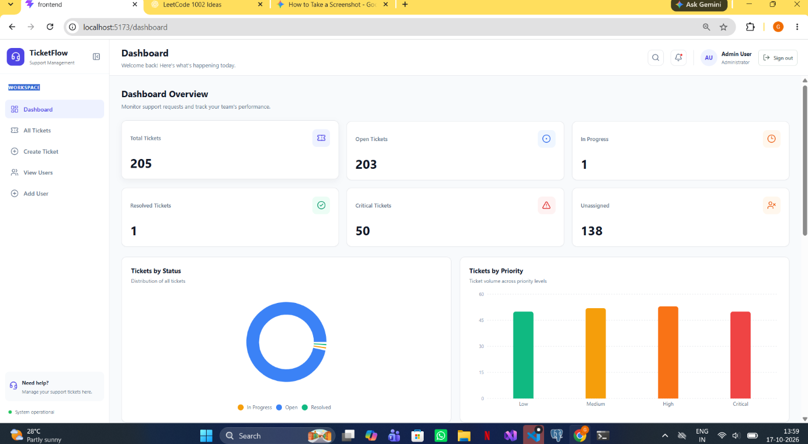
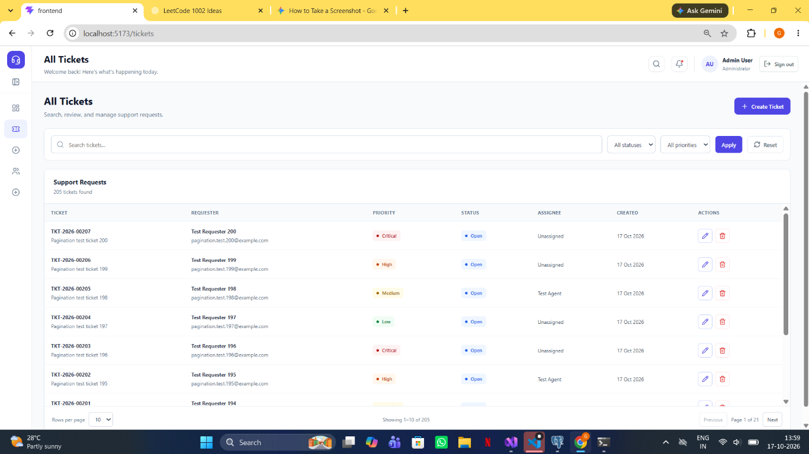
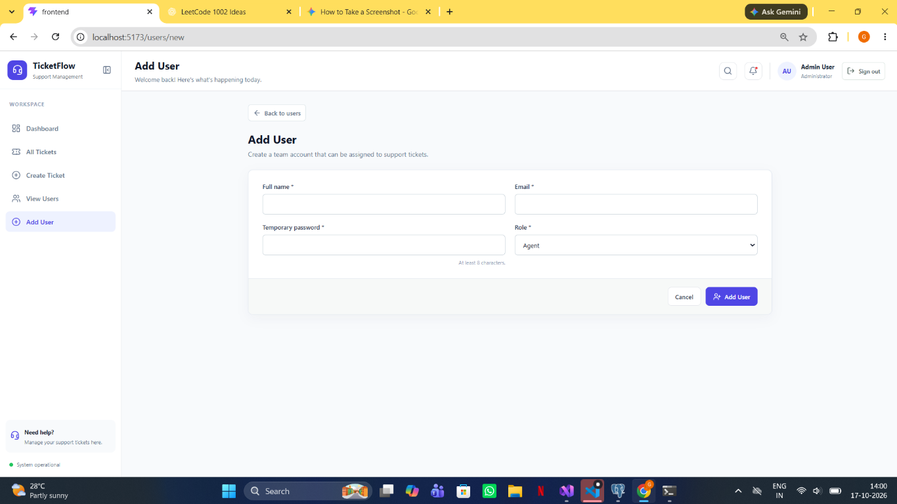
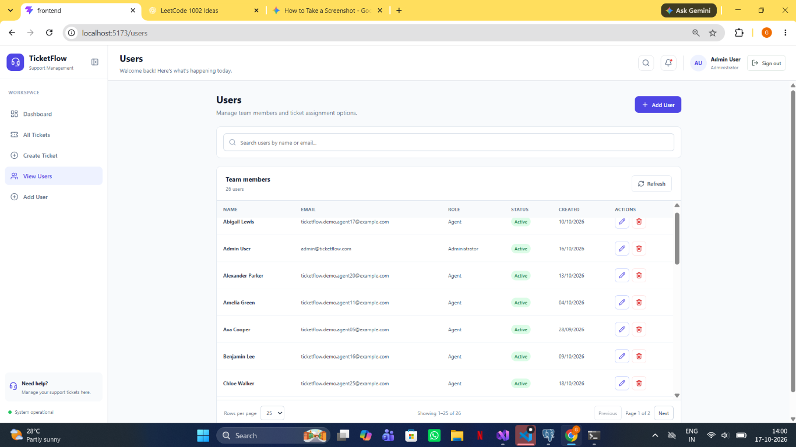
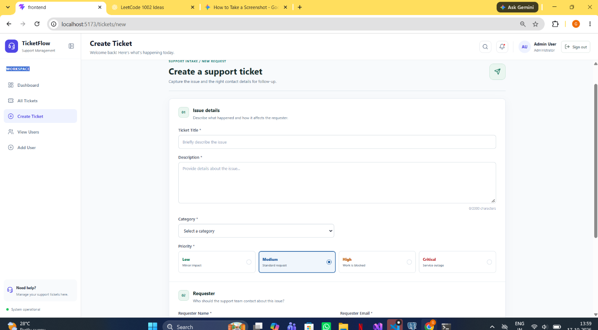

# TicketFlow

TicketFlow is a support-ticket management application built with a React
frontend, an ASP.NET Core Web API, and PostgreSQL. It provides a shared
workspace for tracking, assigning, and resolving support requests.

## Application screenshots

Screenshots captured from the running application:

| Dashboard | Tickets |
|---|---|
|  |  |

| Add user | User management |
|---|---|
|  |  |

### Create a ticket



## Live frontend demo

The browser-only frontend demo is configured for [Vercel](https://vercel.com/new).
Import `Ganesh-M-hash/TicketFlow` and set the project root directory to
`frontend`. Vite's production configuration enables demo mode automatically,
and `frontend/vercel.json` supports direct links to application routes.

> Live demo: deployment pending

### Demo login

- Email: `admin@ticketflow.demo`
- Password: `TicketFlowDemo!2026`

The interactive demo seeds sample tickets and team members in the visitor's
browser. Changes are stored only in that browser's local storage; they are
not shared between visitors or devices and do not reach the backend. Do not
enter real passwords or personal information.

The ASP.NET API and PostgreSQL database are not deployed. This frontend-only
demo is for exploring the interface with sample data, not for production use.

## Project structure

- `frontend/` — React 19 user interface, routing, API client, and styles.
- `TicketFlow/` — ASP.NET Core API, service layer, EF Core data access, and
  PostgreSQL migrations.

## Features

- JWT authentication and protected routes.
- Dashboard summary cards, ticket charts, recent tickets, and trends.
- Ticket search, status and priority filters, and server-side pagination.
- Ticket creation, editing, assignment, status updates, and soft deletion.
- Administrator user management with server-side search and pagination.
- User creation, editing, active status, and soft deletion.
- Reusable table, loading, empty-state, confirmation dialog, and toast UI.

## Run locally

### Backend

1. Install the .NET SDK required by `TicketFlow/TicketFlow.csproj` and run
   PostgreSQL.
2. Set `ConnectionStrings:DefaultConnection` and the `Jwt` settings in local
   configuration. Never commit real database credentials or JWT signing keys.
3. From the repository root:

   ```powershell
   dotnet ef database update --project TicketFlow/TicketFlow.csproj
   dotnet run --project TicketFlow/TicketFlow.csproj
   ```

### Frontend

```powershell
cd frontend
npm install
npm run dev
```

The Vite development server proxies `/api` to the local backend. Configure an
API URL or production proxy when deploying.

## Validate the frontend

From `frontend/`:

```powershell
npm run lint
npm run build
```

## What this project demonstrates

- Align frontend API handling with backend contracts. Ticket and user list
  endpoints return paged response objects, so the UI sends page parameters and
  renders the returned items and page metadata.
- Enforce authorization at both API and UI route boundaries. User management
  and the user-list endpoint require an Administrator role.
- Reuse service modules for API calls and shared UI patterns for consistent
  loading, empty, error, confirmation, and success states.
- Build a ticket assignment flow against the actual user API instead of
  assuming the user list is a plain array or fits in one page.

## API overview

- `GET /api/tickets?search=&status=&priority=&page=1&pageSize=10`
- `GET /api/users?search=&role=&page=1&pageSize=25`
- Both list endpoints return `items`, `page`, `pageSize`, `totalCount`, and
  `totalPages`.
- User administration API routes require the Administrator role.
